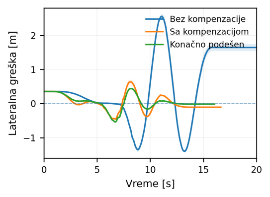
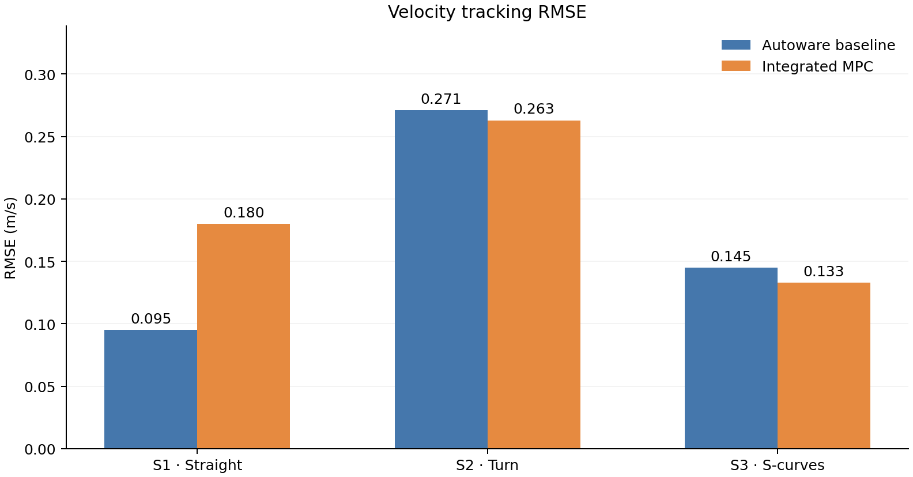
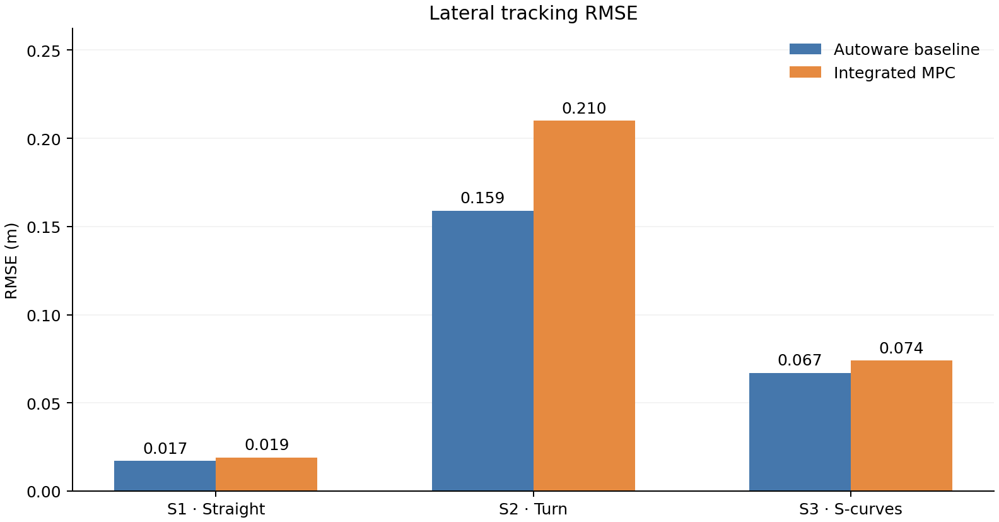
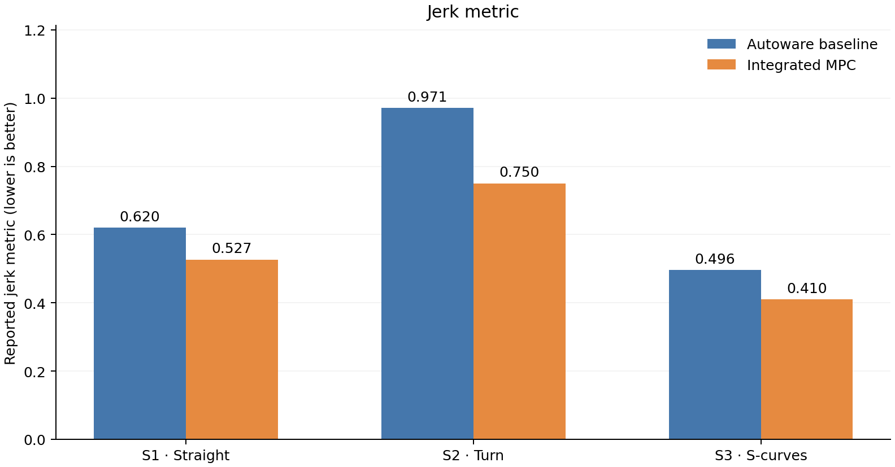

# Integrated Longitudinal–Lateral MPC Controller for Autoware

**Research implementation of a coupled longitudinal and lateral Model Predictive Controller (MPC) for autonomous vehicle trajectory tracking in Autoware / ROS 2.**

> **Research prototype — simulation evaluated.** This controller is not a production-validated automotive control system. The results below refer to the specific Autoware configuration and simulation scenarios used in the research, not to all Autoware releases or real-world driving.

## Overview

The evaluated Autoware baseline uses separate lateral and longitudinal control components: a lateral MPC controller for path tracking and a longitudinal feedforward + PI/PID-based controller for velocity tracking. Since longitudinal speed affects lateral motion and curvature tracking, this project investigates **joint optimization of steering and longitudinal motion** in a single MPC problem.

This repository provides the integrated ROS 2 controller implementation, configuration files, development and sanity-check tools, automated parameter-tuning scripts, and experimental benchmark data used for comparison with the baseline architecture.

### Contributions

- A coupled vehicle motion controller with a joint prediction model and optimization problem.
- A kinematic bicycle model expressed relative to a reference trajectory, including steering actuator dynamics and longitudinal acceleration.
- Steering-angle, steering-rate, acceleration, and jerk constraints.
- Actuator-delay compensation using previously issued control commands to predict the state at which the new command takes effect.
- ROS 2 / Autoware integration and scenario-based evaluation against the decoupled baseline.
- Experimental datasets, scripts, and controller tuning artifacts.

## Method at a glance

The state and control vectors are

$$
\mathbf{x}=\begin{bmatrix} e_y & e_\psi & e_v & \delta & a \end{bmatrix}^{\!T},\qquad
\mathbf{u}=\begin{bmatrix} \delta_{\mathrm{cmd}} & j \end{bmatrix}^{\!T},
$$

where $e_y$ is lateral tracking error, $e_\psi$ is heading error, $e_v=v-v_{\mathrm{ref}}$ is velocity error, $\delta$ is steering angle, $a$ is acceleration, $\delta_{\mathrm{cmd}}$ is commanded steering angle, and $j$ is commanded jerk. The model is linearized along the reference trajectory and discretized using zero-order hold; the resulting quadratic program is solved with **OSQP** in a receding-horizon loop.

| Model / control setting | Evaluated value |
| --- | ---: |
| Prediction horizon | 50 steps |
| Prediction step | 0.1 s |
| Control period | 0.03 s |
| Wheelbase | 2.79 m |
| Steering actuator time constant | 0.27 s |
| Steering-angle limit | ±0.7 rad |
| Acceleration limits | −5 to +3 m/s² |
| Jerk limits | −5 to +2 m/s³ |

These settings describe the **evaluated configuration** in the paper, not universal requirements of the software. See [`config/`](config/) for the repository's parameter files.

## Experimental evaluation

The controller was evaluated using the **Autoware Planning Simulator** and **Scenario Simulator** in three scenarios:

| Scenario | Description | Use |
| --- | --- | --- |
| S1 | Straight-line driving | Evaluation |
| S2 | Single turn | Controller tuning and evaluation |
| S3 | Consecutive curves in opposite directions | Held-out validation and evaluation |

Three successful runs were performed for each controller–scenario combination (**18 successful runs total**). The tables below reproduce mean values reported in the associated paper; the original paper also reports standard deviations.

### Velocity tracking error (RMSE, m/s)

| Scenario | Autoware baseline | Integrated MPC | Lower value |
| --- | ---: | ---: | --- |
| S1 | **0.095** | 0.180 | Baseline |
| S2 | 0.271 | **0.263** | Integrated MPC |
| S3 | 0.145 | **0.133** | Integrated MPC |

### Lateral tracking error (RMSE, m)

| Scenario | Autoware baseline | Integrated MPC | Lower value |
| --- | ---: | ---: | --- |
| S1 | **0.017** | 0.019 | Baseline |
| S2 | **0.159** | 0.210 | Baseline |
| S3 | **0.067** | 0.074 | Baseline |

### Jerk metric (as reported in the paper)

| Scenario | Autoware baseline | Integrated MPC | Lower value |
| --- | ---: | ---: | --- |
| S1 | 0.620 | **0.527** | Integrated MPC |
| S2 | 0.971 | **0.750** | Integrated MPC |
| S3 | 0.496 | **0.410** | Integrated MPC |

**Main finding.** The integrated MPC reduced the reported jerk metric in all three scenarios and improved velocity tracking in S2 and S3. The baseline maintained better lateral and heading tracking accuracy in the more dynamic scenarios, with lower steering activity. These are trade-offs, not a claim that either controller is superior in every metric.

### Actuator-delay compensation

In the S2 development experiment, lateral RMSE was approximately **1.53 m without delay compensation** and **0.23 m with delay compensation** (an improvement of approximately **85%**). The run without compensation did not successfully complete the scenario. The paper also reports an approximately **91% reduction in heading RMSE** for that comparison.

*Original plot from the associated Serbian-language paper (labels in Serbian). The three curves represent no compensation, compensation, and the finally tuned configuration. See the paper for experimental context.*

### Runtime

The integrated controller's reported mean execution time was **2.20–2.26 ms**, with approximately **3–4 ms P95**, compared with a **30 ms control period** in the tested simulation configuration. These timings are environment-specific and should not be interpreted as real-time guarantees on other hardware.

### Visual comparison of benchmark metrics

*Charts reproduce the rounded mean values in Tables 1–3 of the accompanying paper. Each metric is plotted separately to avoid mixing units; error bars are omitted here (consult the paper for standard deviations).*

## Repository contents

| Path | Purpose |
| --- | --- |
| [`src/`](src/) and [`include/`](include/) | C++ controller implementation and interfaces |
| [`config/`](config/) | MPC configuration and tuned parameter variants |
| [`launch/`](launch/) | ROS 2 launch files |
| [`scripts/`](scripts/) | Development tools, checks, and parameter tuning |
| [`benchmark/`](benchmark/) | Scenario scripts, analyses, datasets, and results |
| [`integration/`](integration/) | Integration helpers and recorded upstream Autoware commit |
| [`docs/`](docs/) | Technical notes; research figures and papers can be added here |

## Getting started

**Compatibility notice:** This repository was developed against a specific Autoware source revision recorded in [`integration/autoware_commit.txt`](integration/autoware_commit.txt). Start by reproducing that revision and matching its ROS 2 environment and dependencies. Compatibility with current Autoware main or other ROS 2 distributions has not been established here.

1. Read [`package.xml`](package.xml) and [`CMakeLists.txt`](CMakeLists.txt) to identify the ROS 2 dependencies and build targets.
2. Set up the matching Autoware workspace and its documented dependencies.
3. Place or clone this repository as a ROS 2 package in the workspace's `src/` directory, avoiding nested or duplicated package discovery.
4. Build the package in that environment, then source the resulting workspace installation.
5. Inspect [`launch/`](launch/) and [`config/`](config/) before starting the controller, and ensure that it does not publish competing control commands alongside the stock trajectory follower.
6. Use the tools and scripts in [`benchmark/`](benchmark/) to inspect the published experimental runs and reproduce selected analyses.

A fully validated, copy-paste installation and experiment-reproduction guide is **not yet available**. Exact installation commands, launch arguments, simulator assets, topic remappings, and hardware requirements should be documented after testing on a clean checkout. Please do not assume the repository is plug-and-play with arbitrary Autoware versions.

## Publications and supporting materials

This implementation accompanies the Serbian-language research paper:

**Marija Ninković**, *Projektovanje i implementacija integrisanog kontrolera kretanja uz oslonac na Autoware platformu* (2026). English title: *Design and Implementation of an Integrated Motion Controller Based on the Autoware Platform*.

The paper describes the mathematical formulation, actuator-delay compensation, simulation setup, and results. It was derived from a master's thesis supervised by Prof. Milan Rapaić at the Faculty of Technical Sciences, University of Novi Sad.

The original Serbian PDF and a clearly labeled **English translation** can be added under `docs/papers/`, subject to the relevant publication and distribution permissions. Do not assign a DOI or assert peer-reviewed publication status unless verified against the publisher's record.

## Citation

If you use this code or its datasets in academic work, **please cite this repository**, and also cite the associated paper when its methodology or findings are used. A machine-readable [`CITATION.cff`](CITATION.cff) file enables GitHub's **Cite this repository** action.

Suggested software citation (until a versioned release and DOI are available):

> Ninković, M. (2026). *Integrated Longitudinal–Lateral MPC Controller for Autoware* [Computer software]. GitHub. https://github.com/Mackooo99/autoware-integrated-mpc-controller

For archival research use, cite a **specific commit or release** so that the referenced implementation is unambiguous. Citation is requested scholarly practice; it is not an extra condition imposed by the Apache-2.0 software license.

## Limitations and future work

- Simulation-only evaluation in the reported study; no real-vehicle validation is claimed.
- The evaluated baseline performed better on lateral and heading accuracy in the more dynamic scenarios.
- Further work includes reducing steering-rate activity and improving actuator modeling.
- Additional clean-environment build verification, reproducibility documentation, and compatibility testing are needed.

## License

The repository declares the [Apache License 2.0](LICENSE). Third-party components, data, and publication PDFs may have their own applicable rights or notices; verify these before redistribution.

## Acknowledgments

Developed as part of master's-level research at the **Faculty of Technical Sciences, University of Novi Sad**, under the supervision of **Prof. Milan Rapaić**. The project builds on the open-source Autoware and ROS 2 ecosystems and uses OSQP for quadratic-program optimization.
